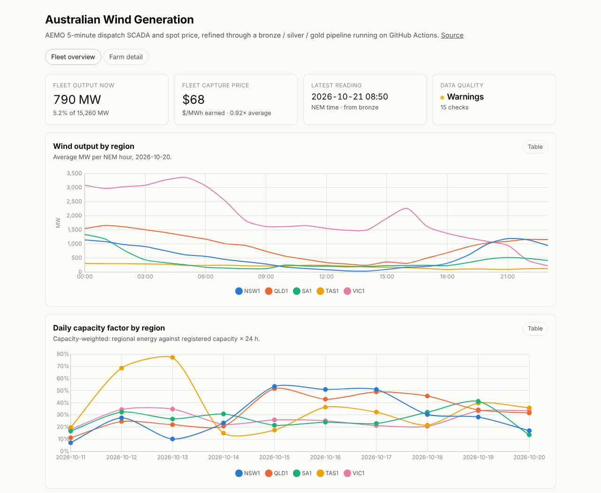
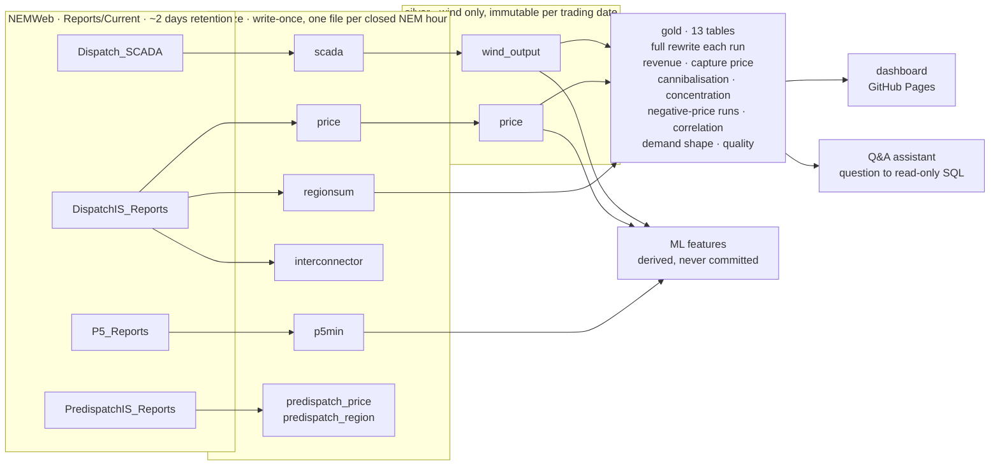

# Australian Wind Power Data Platform

A serverless data platform for Australian wind generation, built on AEMO's
public market data.

Every five minutes AEMO publishes the metered output of every generating unit in
the National Electricity Market, and the spot price each region is settled at.
This project collects both feeds, keeps the wind farms, and refines them into a
queryable history of Australian wind generation *and what it earned* — then puts
a dashboard and a natural-language Q&A assistant on top of it.

The whole thing runs on GitHub Actions and stores its data in this repository.
No cloud account, no database server, no paid services.

**[See the live dashboard →](https://tiger13tiger.github.io/WindPowerProject_AEMO20261013/)**

[](https://tiger13tiger.github.io/WindPowerProject_AEMO20261013/)

It rebuilds itself after every ingest, so the figures above are whatever the
market was doing when you loaded this page.

## Architecture



One download can feed several bronze tables: `DispatchIS` carries price,
regional demand and interconnector flows in one zip, so it is fetched once and
parsed three ways, each with its own watermark. Forecast sources keep the run
time AEMO issued them at, because the leakage rule depends on it.

| Layer | What it holds | Committed |
|-------|---------------|-----------|
| **raw** | The downloaded `PUBLIC_*.zip` | No — transient |
| **bronze** | Every DUID and region as published, columns untouched. One Parquet per closed NEM hour, never rewritten. | Yes |
| **silver** | Wind only. Interval start and end in UTC and NEM local, deduplicated, quality-flagged. One immutable file per trading date. | Yes |
| **gold** | Aggregates and dashboard-ready tables, rewritten in full each run. | Yes |
| **features** | The ML feature table, rebuilt from silver on demand. | No — gitignored |

Every column of every table is listed in
[`DATA_DICTIONARY.md`](DATA_DICTIONARY.md), which is generated from the models
and the Parquet rather than written by hand.

## Stack

Python 3.11 · DuckDB · Parquet · GitHub Actions · GitHub Pages

No new dependencies for the assistant: any OpenAI-compatible endpoint over the
`httpx` the pipeline already uses. No API key is required to clone, test or
run CI.

## Data source

Two public, unauthenticated NEMWeb feeds, both published every 5 minutes:

- [Dispatch SCADA](https://nemweb.com.au/Reports/Current/Dispatch_SCADA/) —
  `PUBLIC_DISPATCHSCADA_*.zip`, MW output per DUID (dispatchable unit identifier).
- [DispatchIS](https://nemweb.com.au/Reports/Current/DispatchIS_Reports/) —
  `PUBLIC_DISPATCHIS_*.zip`, whose `DISPATCH_PRICE` table holds the regional
  reference price (RRP, $/MWh) that generators are settled against.

AEMO keeps only about two days in `Current/`, so ingestion runs hourly and
backfills from a watermark rather than assuming every scheduled run fires.

AEMO data is used under the terms of its
[copyright permissions](https://aemo.com.au/privacy-and-legal-notices/copyright-permissions).
This project is not affiliated with AEMO.

## Status

Ingestion is live: seven bronze tables from four NEMWeb reports, written one
Parquet per closed NEM hour and committed back to this repository. Silver joins
output to price as a wind-only, quality-flagged table, one immutable file per
trading date. Gold is rewritten in full each run, and answers rather
more than "how much did it generate":

| Question | Table |
|---|---|
| What did each farm produce and earn? | `farm_daily`, `farm_revenue_daily` |
| Is wind worth more or less than the average MWh? | `capture_price` |
| Does wind earn less *because* wind is blowing? | `cannibalisation` |
| How much of the revenue arrives in how few intervals? | `revenue_concentration` |
| How long does a negative price actually last? | `negative_price_runs`, `negative_price_worst` |
| Which farms generate at the same time as each other? | `output_correlation`, `farm_correlation` |
| Does the wind arrive when demand does? | `demand_shape` |
| How much available wind did not run, and why? | `curtailment` |
| What is the fleet doing right now? | `latest_snapshot` |
| What does a region's output look like hour by hour? | `region_hourly` |
| Did the checks run, and did they pass? | `quality` |

A static dashboard on GitHub Pages reads JSON slices exported from gold, with a
per-farm page that pairs each farm's output shape against its region's price
shape. The assistant turns a question into read-only SQL over gold and prints
the answer with the query that produced it.

The forecasting phase is built but gated: the feature table, walk-forward folds
with purge and embargo, the metrics and the battery backtest all exist and are
tested, and `build_features.py` reports how far off a trainable fold still is.
It refuses to train on nine days of history, which is the honest answer.

See [`PLAN.md`](PLAN.md) for the repository layout, design decisions and build
steps, and [`DATA_DICTIONARY.md`](DATA_DICTIONARY.md) for every column of every
table, generated from the models rather than written by hand.

## Running it yourself

The pipeline needs two repository settings that cannot be set from a workflow:

- **Settings → Actions → General**: allow all actions, and give workflows
  **read and write** permissions, so the hourly ingest can commit data back.
- **Settings → Pages → Build and deployment → Source: GitHub Actions**, before
  the first dashboard deploy. The automatic token can deploy to a Pages site but
  cannot create one, so this is a one-time manual step.

Locally:

```bash
python3.11 -m venv .venv && source .venv/bin/activate
pip install '.[dev,reference]'
pytest -q                                    # full suite, no network needed
python scripts/export_dashboard.py           # gold + silver -> docs/data/
python -m http.server 8000 --directory docs  # then open localhost:8000

python assistant/eval.py                     # scores the assistant; no key needed
python scripts/data_dictionary.py --check     # dictionary matches the models
python assistant/qa.py "which farms earned the most?"
```

The assistant needs a model API key only to answer *new* questions. Put one in
`.env` (gitignored):

```bash
DEEPSEEK_API_KEY=sk-...        # or ASSISTANT_PROVIDER=openai + OPENAI_API_KEY
```

## Licence

Code is [MIT](LICENSE). The market data under `data/` is AEMO's, published
under its
[copyright permissions](https://aemo.com.au/privacy-and-legal-notices/copyright-permissions),
and is not covered by that licence.

## Background

Built by a data engineer and former wind turbine maintenance engineer, as a
portfolio project bridging data engineering and AI engineering.
